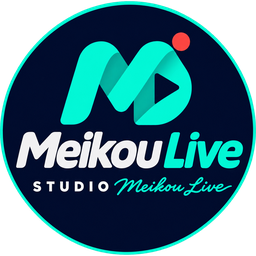

# Meikou Live Studio 2

免費、開源的導播軟體（Windows／macOS）。介面是全新設計的導播台，畫面合成、擷取、編碼、推流使用 OBS Studio 的開源核心 libobs，所有功能內建，不需要另外安裝外掛。

> 本專案不是 OBS Project 的官方產品，也不隸屬於 OBS Project。

## 下載

到 [Releases](../../releases) 下載最新版本：

**Windows 10／11（64 位元）**
- `*-Windows-x64-Setup.exe`：點兩下就會自動安裝，裝好自動開啟，並建立桌面捷徑。
- `*-Windows-x64-portable.zip`：免安裝版，解壓縮後執行 `bin\64bit\meikou-live-studio.exe`。
- 安裝檔尚未數位簽章，Windows 可能跳出 SmartScreen 警告，按「其他資訊 → 仍要執行」。

**macOS 13 以上（Apple Silicon M 系列晶片）**
- `*-macOS-AppleSilicon.pkg`：點兩下安裝到「應用程式」資料夾。
- 安裝檔尚未經 Apple 公證，第一次若出現「無法驗證開發者」，到「系統設定 → 隱私權與安全性」按「強制打開」。
- 第一次使用攝影機、麥克風、螢幕擷取時，macOS 會詢問權限，請按「允許」。

## 目前功能（開發中，M2）

- 預覽／播出雙畫面，CUT 與 AUTO 轉場（多種轉場效果、可調時間）
- 訊號源：攝影機／擷取卡／導播機 USB、螢幕、視窗、遊戲擷取、網路影片（RTMP／SRT／RTSP／HLS）、影片、圖片、純色、文字
- 疊加：台標、人名條、跑馬燈、時鐘、圖片、文字；先上預覽再一起送出，可在預覽拖曳、縮放
- 混音台：音量表、推桿、靜音／監聽／關閉；開啟即自動載入系統聲音與麥克風
- 推流：同時推多個平台（YouTube、Facebook、Twitch、自訂 RTMP／RTMPS），只編碼一次；自動選顯示卡編碼器、斷線自動重連、網路壅塞自動降碼率、低延遲
- 錄影：MKV
- 1920×1080 輸出，24／25／29.97／30／60 fps

串流金鑰只存在你自己的電腦上，不會上傳。

## 回報問題

程式右上角「紀錄檔」按鈕會打開紀錄資料夾，回報問題時請附上最新一份。

## 原始碼結構

- `meikou/`：Meikou 程式原始碼（C++／Qt 6）
- `obs-studio/`：OBS Studio 原始碼（子模組，鎖定 33.0.3）
- `installer/`：Windows 一鍵安裝程式（NSIS）
- `.github/workflows/build.yml`：GitHub Actions 自動建置 Windows 與 macOS，推到 `main` 就會產出安裝檔並發布到 Releases

建置時會在 `obs-studio/CMakeLists.txt` 加一行 `add_subdirectory(../meikou)`，沿用 OBS 的相依套件與輸出目錄，
並關閉 OBS 自己的介面（`ENABLE_FRONTEND=OFF`）、網頁來源與腳本。

## 授權

本專案以 GNU General Public License v2.0 或更新版本（GPL-2.0-or-later）釋出，詳見 [LICENSE](LICENSE)。
內含的 OBS Studio／libobs、FFmpeg、x264 等元件依其各自的授權條款使用；Qt 6 依 LGPL-3.0 使用。
